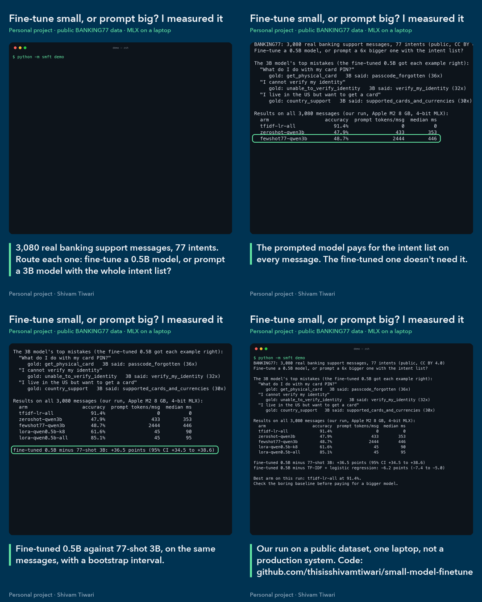
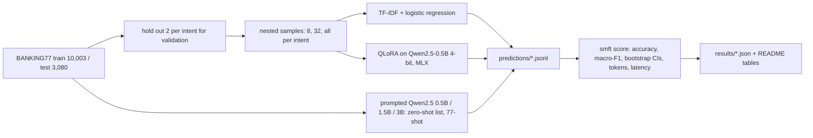

# small-model-finetune

When does a LoRA fine-tune of a **0.5B** model beat prompting a model **6x its size** with the full intent list?
Measured on BANKING77 (3,080 real online-banking support messages, 77 intents) on one laptop: accuracy with
bootstrap intervals, tokens per message, latency, training time, and a learning curve against a TF-IDF baseline.

A personal portfolio project. Built with Claude Code as a pair programmer.

> Design notes, failure modes and interview Q&A: [STUDY.md](STUDY.md). Spec: [docs/SPEC.md](docs/SPEC.md).



Demo video: [docs/demo.mp4](docs/demo.mp4) (27 s).

## Problem

Banks and fintechs route every support message to one of many narrow intents ("my card hasn't arrived", "wrong
exchange rate on a cash withdrawal", "top-up reverted") so it reaches the right queue or automation. A common first
version prompts a large general model with the whole intent list on every message. That works, but each message pays
for hundreds or thousands of prompt tokens, latency follows the model size, and accuracy on fine-grained,
overlapping intents is often not good enough to automate. The question a team faces: how much labelled data does it
take before a small fine-tuned model is the better deal, and is it better than a classic classifier at all?

## Approach



- **Data** (`data.py`): BANKING77 (PolyAI, CC BY 4.0), the official split. Two examples per intent are held out of
  the training split for LoRA validation; every arm trains on the remaining 9,849. Training samples are nested
  (the 8-per-intent sample is inside the 32), so the curve adds data rather than swapping it. 6 test texts also
  appear word for word in the training split; they are left in, as in the published split.
- **Baseline** (`baseline.py`): word 1–2-gram and character 2–5-gram TF-IDF, logistic regression. Deterministic; CI
  reruns it.
- **Prompted arms** (`prompts.py`, `infer.py`): Qwen2.5-Instruct 0.5B, 1.5B and 3B, 4-bit MLX, greedy. The system
  prompt lists all 77 labels; the few-shot arm adds one labelled training example per intent as earlier chat turns.
  The fixed prefix is prefilled once into a KV cache and reused, as an API prompt cache would, so latency counts only
  each message's own tokens; the token columns still count the full prompt, which is what an API bills.
- **Fine-tuned arms** (`train.py`): QLoRA (rank 8, 16 layers) on the 4-bit 0.5B base with `mlx_lm.lora`, loss on
  the label tokens only. The prompt has no label list. Batch 8 with 2-step gradient accumulation and gradient
  checkpointing: batch 16 ran out of GPU memory on 8 GB. Epochs per size were set on validation loss (k=8 at 4
  epochs was still falling, so it trains for 8; `results/train_k8_4epochs.json`).
- **Parsing** (`parse.py`): the exact label after light clean-up, or the single label named in the reply. No fuzzy
  matching, so a near-miss counts as invalid and wrong.
- **Scoring** (`metrics.py`, `report.py`): accuracy and macro-F1 with 95% bootstrap intervals; paired bootstrap for
  differences on the same messages.
- **Eval gate in CI**: reruns the baseline, re-scores every committed prediction file, checks `results/` and these
  tables match, and fails if the headline comparison stops holding. The LLM arms need Apple silicon, so CI checks
  their committed predictions instead of rerunning them.

## Results

**In one line:** the fine-tuned 0.5B model beat the prompted 3B model by 36.5 points (85.1% vs 48.7%) while
reading 55x fewer prompt tokens per message, and even 8 examples per intent were enough to beat it. But a TF-IDF +
logistic regression classifier beat every LLM arm at every training size (91.4% on the full data, trained in 13 s).

Every number below comes from `results/*.json`, generated by `python -m smft score` from `predictions/*.jsonl`. One
run, Apple M2 with 8 GB, MLX 0.32, mlx-lm 0.32.2.

<!-- RESULTS:START -->
| Arm | Trained on | Accuracy % (95% CI) | Macro-F1 % | Invalid % | Prompt tokens / 1k msgs | Median latency ms |
|---|---|---|---|---|---|---|
| tfidf-lr-k8 | 616 examples | 70.7 (69.0–72.3) | 70.5 | 0.0 | 0 | 0.0 |
| tfidf-lr-k32 | 2,464 examples | 86.0 (84.8–87.2) | 85.9 | 0.0 | 0 | 0.1 |
| tfidf-lr-all | 9,849 examples | 91.4 (90.4–92.3) | 91.4 | 0.0 | 0 | 0.1 |
| zeroshot-qwen0.5b | none | 19.7 (18.2–21.0) | 18.0 | 26.2 | 432,600 | 65.6 |
| zeroshot-qwen1.5b | none | 40.7 (39.0–42.4) | 38.2 | 5.2 | 432,600 | 188.3 |
| zeroshot-qwen3b | none | 47.9 (46.2–49.6) | 46.6 | 5.9 | 432,600 | 353.1 |
| fewshot77-qwen3b | 77 shots in prompt | 48.7 (46.9–50.4) | 48.7 | 6.5 | 2,443,600 | 446.2 |
| lora-qwen0.5b-k8 | 616 examples | 61.6 (59.9–63.2) | 62.7 | 4.5 | 44,600 | 90.0 |
| lora-qwen0.5b-k32 | 2,464 examples | 71.3 (69.7–72.9) | 71.8 | 1.3 | 44,600 | 94.1 |
| lora-qwen0.5b-all | 9,849 examples | 85.1 (83.9–86.4) | 85.1 | 0.2 | 44,600 | 94.7 |

| Paired comparison (same 3,080 messages) | Accuracy difference, points (95% CI) |
|---|---|
| lora-qwen0.5b-all vs fewshot77-qwen3b | 36.5 (34.5 to 38.6) |
| lora-qwen0.5b-all vs zeroshot-qwen3b | 37.2 (35.3 to 39.1) |
| lora-qwen0.5b-k8 vs fewshot77-qwen3b | 12.9 (10.8 to 14.9) |
| lora-qwen0.5b-all vs tfidf-lr-all | -6.2 (-7.4 to -5.0) |
| lora-qwen0.5b-k8 vs tfidf-lr-k8 | -9.1 (-11.0 to -7.2) |
| lora-qwen0.5b-k32 vs tfidf-lr-k32 | -14.7 (-16.5 to -13.1) |
<!-- RESULTS:END -->

Notes on the columns: latency for the LLM arms is per message with the fixed prompt prefix already cached (greedy,
one message at a time); TF-IDF latency is its batch prediction time divided by 3,080, so it is not comparable
one-to-one. Prompt tokens are Qwen2.5 tokens for the full chat prompt. Training time is wall-clock on the M2:
TF-IDF 1–13 s, LoRA 12–23 minutes (`results/train_*.json`).

### What it means

- **Label conventions beat model size.** BANKING77's intents encode the dataset's own conventions: all 40
  `get_physical_card` test messages ask about a PIN, so the 77-shot 3B model called 36 of them `passcode_forgotten`;
  `country_support` and `fiat_currency_support` collapse into `supported_cards_and_currencies`. A list of label
  names can't carry that; labelled examples can. That is why 616 examples moved a 0.5B model from 19.7% (zero-shot)
  to 61.6%.
- **Few-shot barely helped.** One example per intent took the 3B model from 47.9% to 48.7% while the prompt grew from
  433 to 2,444 tokens per message.
- **The prompted models invent labels.** 5–7% of the 1.5B and 3B replies are not one of the 77 (`get_virtual_card`,
  `source_of_funds`); the 0.5B model invents 26%. Fine-tuning drives that to 0.2%.
- **The boring baseline wins here.** Short, keyword-heavy messages with 130 examples per intent are a good case for
  n-gram features. On this task, the fine-tune is worth it only against a prompted LLM, not against a classifier.
  The LoRA runs were short (1–8 epochs, rank 8, a 0.5B base, chosen to fit 8 GB), so this is "our LoRA on a laptop",
  not the ceiling for fine-tuning: the dataset paper (Casanueva et al., 2020, arXiv:2003.04807) reports about 93%
  for its full-data intent models.

## Limitations

- One run per arm and one seed; the intervals cover test-set sampling, not training randomness.
- The bigger model is a 4-bit 3B model, not a frontier API model. A frontier model would likely do much better
  zero-shot; the Gemini arm waits for an API key, and no API prices are claimed here.
- LoRA hyperparameters were not tuned beyond the epoch count (on validation loss). k=32 got only 2 epochs, which may
  explain why it trails TF-IDF by more than k=8 does.
- Latency is single-stream on one laptop; batched serving would change the absolute numbers for every LLM arm.
- BANKING77 is single-domain English with short messages; long or multilingual messages may favour LLMs.

## Next steps

- A frontier-API arm (Gemini, zero- and few-shot) with logged cost per 1,000 messages.
- Three seeds per LoRA size, more epochs and rank, and a 1.5B base, to see where the LoRA curve crosses TF-IDF.
- A hybrid router: TF-IDF first, LLM only when the classifier's top probability is low; measure accuracy against the
  share of traffic sent to the LLM.
- Calibration: abstain below a confidence threshold, as a support queue would.

## Reproduce

```bash
uv sync --extra mlx                 # Apple silicon; `uv sync` alone is enough for the baseline, tests and the gate
python -m smft download             # BANKING77 parquet files (already committed under data/raw)
# MLX 4-bit weights from huggingface.co/mlx-community into ~/.cache/smft (or set MODEL_DIR):
#   Qwen2.5-0.5B-Instruct-4bit, Qwen2.5-1.5B-Instruct-4bit, Qwen2.5-3B-Instruct-4bit
./run_all.sh                        # baseline, 3 LoRA runs, 7 LLM arms, score (about 2 hours on an M2)
# or just the headline arm with the committed adapter (models/lora-qwen0.5b-all, 11.7 MB), about 5 minutes:
uv run python -m smft infer --arm lora-qwen0.5b-all --out /tmp/lora-all.jsonl
uv run python -m smft ci            # the CI gate
uv run python -m smft demo          # terminal walkthrough of the results
```
